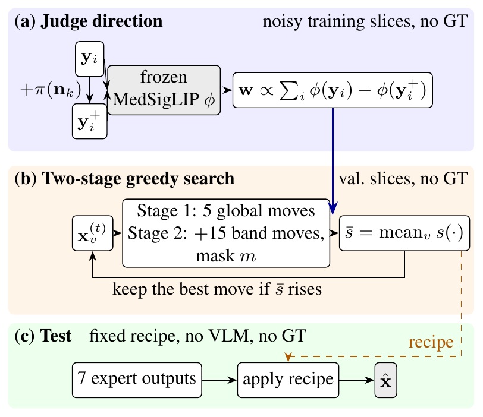
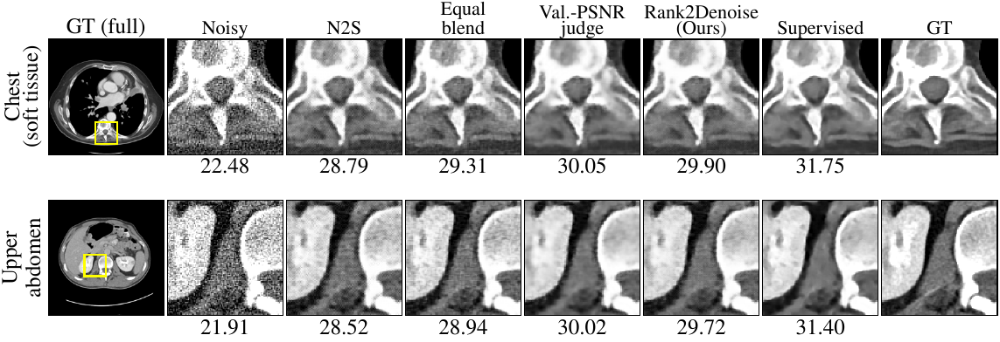

# Rank2Denoise: choosing band-wise post-hoc recipes without ground truth for self-supervised low-dose CT denoising

> Code for the paper submitted to **IEEE ISBI 2027**.

**Batuhan Gedik**<sup>1,2</sup> · **Mehmet Ozan Ünal**<sup>1,2</sup> · **Metin Ertaş**<sup>2</sup> · **İsa Yıldırım**<sup>1,2</sup>

<sup>1</sup> Department of Electronics and Communication Engineering, Istanbul Technical University<br>
<sup>2</sup> Biomedical Imaging and AI Laboratory (BIAI Lab), Istanbul, Turkey

---

## Abstract

Self-supervised denoisers for low-dose CT (LDCT) learn from noisy scans alone, but choosing and combining them still
relies on clean images, which are rarely available. Most ground-truth (GT)-free judges require an explicit noise model or
high-quality images, so we build our own vectorised metric using vision language model (MedSigLIP in this research)
encodings. Seven expert denoisers process each slice, and the metric measures how much each small edit toward their
outputs improves the image. This approach lets the search find the best way to combine them. To do so, the search scores
each step separately, rejects edits that make the images noisier, and turns to another expert or frequency band instead.
These selected edits improve PSNR and SSIM, and they recover 73% of the PSNR gain that a ground-truth-based judge
achieves over a simple equal blend, demonstrating the impact of the VLM-based judge.

---

## Contents

- [Method](#method)
- [Experimental setup](#experimental-setup)
- [Results](#results)
- [Where ground truth is used](#where-ground-truth-is-used)
- [Implementation settings](#implementation-settings)
- [Limitations](#limitations)
- [Ethics and acknowledgments](#ethics-and-acknowledgments)
- [Installation](#installation)
- [Data](#data)
- [Running the pipeline](#running-the-pipeline)
- [Citation](#citation)
- [License](#license)
- [References](#references)

---

## Method

CT datasets that pair each low-dose scan with a clean reference image are scarce, so self-supervised denoisers learn
from noisy images only [1–5]. Each denoiser has its own noise assumption, and since reconstructed CT noise is spatially
correlated, each removes different noise components. Combining them usually needs PSNR against clean images, which
brings back the GT that self-supervision avoids. Rank2Denoise selects and combines self-supervised denoisers without
clean images.

Existing GT-free evaluation methods do not fit this setting. Risk estimators such as PURECOMB [6] assume independent
noise, and the J-invariant loss [1] evaluates individual networks rather than combinations. Learned quality metrics need
extra supervision: CLIP-IQA [7] takes its quality direction from text, RAVE [8] from curated high- and low-quality image
sets, and SSIQA [9] trains a CT noise-level regressor. Noisier2Noise [10] adds noise to noisy images only to make
training targets.

Adding the noise of one slice to another noisy slice gives a copy that is surely noisier. In the embedding space of a
frozen medical vision language model (MedSigLIP [11]), the mean difference between slices and their noisier copies gives a
"less noisy" direction. This direction needs no text, no clean images and no explicit noise model. The score along this
direction guides a greedy search over post-hoc, band-wise moves toward several denoisers. The judge selects the recipe
and is not used at test time.

<p align="center">
  
</p>

**Fig. 1.** Method. (a) A direction $\mathbf{w}$ in the frozen MedSigLIP space points from re-noised copies $y_i^+$
towards their noisy sources $y_i$. (b) A recipe is grown greedily on validation slices, judged by the mean score
$\bar{s}$. (c) The fixed recipe is applied at test time.

### Experts

Rank2Denoise uses seven self-supervised denoisers as experts. $\hat{\mathbf{x}}_e(y)$ is the output of expert $e$ for
a noisy slice $y$.

| Expert | Method | Mechanism |
| --- | --- | --- |
| **N2S** (base expert) | U-Net, Noise2Self loss [1] with complementary checkerboard masks | blind-spot masking |
| N2N | the same U-Net, Neighbor2Neighbor loss [3] | neighbour sub-sampling |
| N2V | Noise2Void [2] | blind-spot masking |
| R2R | Recorrupted-to-Recorrupted [4], re-corrupted with N2S noise fields | re-corruption |
| B2U | Blind2Unblind [12] | blind-spot masking |
| S2S | dataset-level Self2Self variant [5] | dropout on a single network |
| Wavelet | BayesShrink wavelet thresholding [13] | classical prior |

N2S is the base expert. It gives the starting image of the search, the noise fields $y - \hat{\mathbf{x}}_S(y)$ for
the judge and the region mask $m$ for the search. For correlated CT noise, the noise assumptions of the experts are only
partially valid, so the experts complement each other.

### Objective

A **recipe** is a short list of small image edits (**moves**). The search solves

$$
\text{recipe}^* = \arg\max_{\text{recipe}} \bar{s}, \qquad
\bar{s} = \frac{1}{|\mathcal{V}|} \sum_{v \in \mathcal{V}} s\big(\text{recipe}(\hat{\mathbf{x}}_S(y_v))\big),
$$

where $\mathcal{V}$ is the set of noisy validation slices and $s$ is the judge score. A higher $\bar{s}$ means less
noisy images on average. No clean image is used to compute $\bar{s}$.

### (a) Judge direction — noisy training slices, no GT

$\phi(\mathbf{x})$ is the L2-normalised image embedding of the frozen MedSigLIP-448 encoder [11]. Before encoding, the
$8\times8$ corners of the slice are set to zero; the slice is resized to $448\times448$, copied to three channels and
scaled to $[-1, 1]$.

For each noisy training slice $y_i$, the N2S noise field is $n_i = y_i - \hat{\mathbf{x}}_S(y_i)$. A re-noised copy
adds the field of another random slice $k$, randomly flipped ($\pi$):
$y_i^+ = \mathrm{clip}(y_i + \pi(n_k), 0, 1)$. As $y_i^+$ is noisier, the mean embedding difference points toward less
noisy images:

$$
\mathbf{w} = \frac{\sum_i \big(\phi(y_i) - \phi(y_i^+)\big)}{\big\lVert \sum_i \big(\phi(y_i) - \phi(y_i^+)\big) \big\rVert_2},
\qquad s(\mathbf{x}) = \langle \phi(\mathbf{x}), \mathbf{w} \rangle .
$$

> **Implementation detail.** The code draws the donor $k$ uniformly from all 647 training slices
> (`src/renoise.py`, `torch.randint`). It does not exclude slice $i$. A slice therefore uses its own noise field with
> probability 1/647. The expected number of such slices is one per direction $\mathbf{w}$. The flip $\pi$ is a
> left–right flip with probability 0.5. The random generator uses seed 42 for all three N2S seeds. So the donor and flip
> draws are the same in every run; only the noise fields change.

A higher $s$ means less noise, so $s$ ranks candidate images (hence the name Rank2Denoise). The judge rests on the N2S
noise fields, so each N2S seed gives its own $\mathbf{w}$. This direction comes from the noise fields in the current
dataset, rather than from a predefined noise model. Therefore, for a new dataset or dose, $\mathbf{w}$ is rebuilt from
its noisy slices.

### (b) Two-stage greedy search — validation slices, no GT

**Stage 1** starts from $\hat{\mathbf{x}}_S$ with five global moves (step $\alpha = 0.1$), each clipped to $[0, 1]$:

$$
T_z(\mathbf{x}) = \mathbf{x} + \alpha (z - \mathbf{x}), \qquad
T_G(\mathbf{x}) = G_{0.5}\,\mathbf{x}, \qquad
T_H(\mathbf{x}) = \mathbf{x} + \alpha H \mathbf{x}.
$$

- $T_z$ shifts $\mathbf{x}$ 10% toward a target image $z$: the noisy input, the N2S output or the N2N output.
- $T_G$ smooths $\mathbf{x}$ with a Gaussian filter of width $\sigma = 0.5$ pixels.
- $T_H$ adds 10% high frequencies; $H$ is an ideal radial high-pass filter (above 0.25 cycles per pixel).

**Stage 2** adds 15 band moves. Each shifts $\mathbf{x}$ toward a frequency band of an expert output, outside the
region mask $m$ ($\odot$ is pixel-wise multiplication):

$$
T_{e,b}(\mathbf{x}) = \mathbf{x} + \alpha (1 - m) \odot B_b(\hat{\mathbf{x}}_e - \mathbf{x}).
$$

$B_b$ extracts the low ($G_4 r$), mid ($G_1 r - G_4 r$) or high ($r - G_1 r$) band of $r = \hat{\mathbf{x}}_e - \mathbf{x}$;
the low band is mean-adjusted to preserve the grey level. Three bands × five experts (wavelet, N2V, R2R, S2S, B2U) give
15 band moves. In stage 2, the five stage-1 moves $\mathcal{T}$ also act only where $m = 0$, as
$\mathbf{x} + (1 - m) \odot (\mathcal{T}(\mathbf{x}) - \mathbf{x})$. Stage 1 itself uses no mask.

**Region rule.** Without a region mask, band moves can shift the background grey level and blur boundaries. The mask
$m$ is one on the background and on boundaries. It is computed once from the N2S output, without GT:

1. **Background.** A pixel is part of the body if its N2S value is at least 0.02 (not dark air) and it is at least
   16 pixels from the image edge; otherwise it is background.
2. **Boundaries.** Within the body, boundaries are the 10% of pixels with the largest gradients. The boundary map is
   dilated by 4 pixels.
3. Both maps are smoothed with $G_2$, and $m$ is their maximum.

Every value in the region rule is set once and not tuned.

**Greedy loop.** At step $t$, every move is applied to the current validation images $x_v^{(t)}$, and the move with the
highest mean judge score is kept:

$$
T_t = \arg\max_{\mathcal{T}} \frac{1}{|\mathcal{V}|} \sum_{v \in \mathcal{V}} s\big(\mathcal{T}(x_v^{(t)})\big),
\qquad x_v^{(t+1)} = T_t(x_v^{(t)}).
$$

A stage ends when $\bar{s}$ stops rising or after 30 moves (four of six searches end earlier). Stage 2 starts from the
result of stage 1, and the recipe is the list of kept moves from both stages.

### (c) Test — fixed recipe, no VLM, no GT

The fixed recipe is applied to each test slice using only the seven expert outputs and the mask $m$, without the VLM.
Only $m$ changes from slice to slice. Each expert runs once, and the recipe adds only weighted sums and fixed filters.
The search runs once per seed, before testing.

---

## Experimental setup

- **Data.** 1301 DeepLesion [14] slices ($512\times512$) from [15], with noise simulated at 10% of the clinical dose,
  as in LoDoPaB-CT [16]. Each slice is clipped to its clinical display window and scaled to $[0, 1]$. The noise is spatially
  correlated.
- **Split.** By patient: 899 training slices (647 used for the experts), 182 validation and 220 test slices.
- **Experts.** N2S, N2N, N2V, R2R and B2U share the same U-Net and training setup (7.70 M parameters; AdamW, learning
  rate $10^{-4}$, batch 8, 30 epochs). They differ only in the self-supervised method, with method settings from the
  original papers. Checkpoints are selected by their own loss on noisy validation data.
- **Seeds.** N2S, N2V, R2R and B2U use seeds 42, 123 and 456 (run $s$ uses the experts of seed $s$). N2N has one run.
  S2S is one network trained on all 899 noisy training-split slices (252 from other training patients).
- **Compute.** Once the experts are trained, the recipe search takes under one hour per seed on an NVIDIA A100 GPU.
- **Metrics.** PSNR and SSIM use a peak value of 1 for every slice (not the slice's own min-to-max range), so
  $\mathrm{PSNR} = 10\log_{10}(1/\mathrm{MSE})$ and scores are comparable across slices. LPIPS [17] uses AlexNet. Results
  are the mean of the three runs.
- **Statistics.** Paired differences are averaged over seeds and patients, then tested with an exact Wilcoxon
  signed-rank test (primary test: PSNR vs. the equal blend; the other tests are uncorrected) and a patient-cluster
  bootstrap 95% CI (5000 draws).

### Compared methods

Rank2Denoise is compared with two groups of references.

- **Plain ensembling** (first group). The equal blend ($0.5\,$N2S $+ 0.5\,$N2N), the average of all seven experts, and
  the equal blend with the 15 band moves applied once each in a fixed order, without a judge. Stage 1 alone measures
  the gain of stage 2.
- **Other judges in the same search** (second group). Only the judge changes, to test whether the gain comes from the
  learned direction $\mathbf{w}$.
  - *Val.-PSNR judge* — PSNR against validation GT; a reference that uses clean images.
  - *Random direction* — a random unit vector instead of $\mathbf{w}$; tests whether the learned direction matters.
  - *ResNet-50 direction* — $\mathbf{w}$ built the same way from ImageNet ResNet-50 features; tests whether a medical
    vision language model is needed.
  - *$Q$ index* — the no-reference index $Q$ [18].
  - *Residual-variance judge* — $-\big|\mathrm{mean}((\mathbf{y}-\mathbf{x})^2) - \hat\sigma^2\big|$, which prefers
    outputs whose removed part $\mathbf{y}-\mathbf{x}$ has the variance of the noise. $\hat\sigma$ is the wavelet (MAD)
    noise estimate [13]; both terms use only $2\times2$ blocks of $\mathbf{y}$ with no clipped pixels.

The four judges other than val.-PSNR, like ours, use no clean image.

---

## Results

### Table 1 — test results

Mean (± sample std) over three seeds. **Gain:** PSNR gain (dB) over the equal blend. **GT:** clean images used.
The last five rows are our search with other judges.

| Method | GT | PSNR ↑ | Gain | SSIM ↑ | LPIPS ↓ |
| --- | :---: | :---: | :---: | :---: | :---: |
| Noisy input | – | 23.04 | – | 0.742 | 0.284 |
| Supervised¹ | train | 31.47 | – | 0.874 | 0.113 |
| N2S | no | 28.54 ± 0.05 | −0.48 | 0.826 | 0.113 |
| N2N¹ | no | 27.84 | −1.18 | 0.815 | 0.136 |
| N2V | no | 26.30 ± 0.07 | −2.72 | 0.776 | 0.158 |
| R2R | no | 25.87 ± 0.05 | −3.15 | 0.667 | 0.193 |
| B2U | no | 27.47 ± 0.17 | −1.55 | 0.815 | 0.183 |
| S2S¹ | no | 28.57 | −0.45 | 0.847 | 0.185 |
| Wavelet¹ | no | 26.05 | −2.97 | 0.808 | 0.187 |
| Equal blend | no | 29.02 ± 0.02 | 0 | 0.841 | 0.102 |
| Equal blend, 7 experts | no | 28.48 ± 0.02 | −0.54 | 0.825 | 0.124 |
| Band moves, no judge | no | 28.99 ± 0.02 | −0.03 | 0.838 | 0.106 |
| Stage 1 only | no | 29.04 ± 0.06 | +0.02 | 0.841 | 0.101 |
| **Rank2Denoise (Ours)** | no | **29.49 ± 0.01** | **+0.47** | 0.853 | **0.098** |
| Ours without S2S moves | no | 29.01 ± 0.13 | −0.01 | 0.840 | 0.101 |
| Random direction | no | 27.70 ± 0.86 | −1.32 | 0.827 | 0.141 |
| ResNet-50 direction | no | 27.66 ± 0.05 | −1.36 | 0.830 | 0.180 |
| $Q$ index | no | 18.54 ± 0.23 | −10.48 | 0.697 | 0.437 |
| Residual-variance judge | no | 28.84 ± 0.05 | −0.18 | 0.836 | 0.105 |
| Val.-PSNR judge | val | 29.66 ± 0.01 | +0.64 | 0.862 | 0.113 |

¹ One run or no training; S2S uses all 899 training slices. Supervised: the same U-Net, MSE loss. R2R shifts the air
level and keeps 1.8× the GT high-frequency power.

### Key findings

- **Gain over N2S.** The recipe raises PSNR over N2S, its starting point, by 0.96 dB (unrounded means) on all 220 test
  slices and 31 patients (CI [+0.87, +1.04] dB).
- **Gain over the equal blend** (primary reference): +0.47 dB ($p < 10^{-7}$; CI [+0.36, +0.58]; 29 of 31 patients).
  SSIM rises from 0.841 to 0.853 ($p < 10^{-5}$). LPIPS falls slightly from 0.102 to 0.098; this drop holds in all three
  seeds and in 21 of 31 patients ($p = 0.04$), but its CI includes zero. This is the only weak result; every other
  difference reported as significant has $p < 10^{-3}$.
- **Not plain mixing or picking.** The recipe beats the best single denoiser, S2S, by 0.92 dB (30 of 31 patients). The
  average of all seven experts is below N2S, and judge-free band moves stay at the equal blend. The judge's choice adds
  0.50 dB (29 of 31 patients).
- **Which experts are used.** In stage 2, S2S high/mid and N2V bands are mostly chosen; R2R, B2U and wavelet are never
  chosen, so removing them leaves the recipe unchanged. Without the S2S moves, the search only matches the equal blend
  (29.01 dB, $p = 0.18$). The judge adds gain only when an expert offers a useful direction that the global moves cannot
  reach, as S2S does in the mid band.
- **Close to GT-based selection.** The val.-PSNR judge lets the same search reach 29.66 dB. Without any clean image,
  Rank2Denoise recovers 74%, 70% and 76% of its gain over the equal blend in seeds 42, 123 and 456; the average of
  them, 73%, is the value in the paper. Rank2Denoise also has a lower LPIPS (0.098 vs. 0.113; $p < 10^{-3}$). The
  PSNR judge keeps less fine detail: its high-frequency power is 46% of the GT power, versus 54% for Rank2Denoise
  (Fig. 2).
- **The gain comes from $\mathbf{w}$.** With a random direction (27.70 dB) or a ResNet-50 direction (27.66 dB), the
  search ends below N2S. Without $\mathbf{w}$, $Q$ collapses to 18.54 dB, and the residual-variance judge stays below the
  equal blend (28.84 dB) and 0.65 dB below ours (30 of 31 patients, $p < 10^{-8}$).

<p align="center">
  
</p>

**Fig. 2.** Test examples (seed 42). Column 1: GT with the $96\times96$ region; others: zoom (same grey range per row)
and full-slice PSNR (dB). Rows: two fixed test slices and regions (`paper/fig2_selection.csv`). CT images: DeepLesion
[14], NIH Clinical Center, with simulated noise from [15].

### What $\mathbf{w}$ measures

- All 647 training differences $\phi(y_i) - \phi(y_i^+)$ point the same way as $\mathbf{w}$ (mean cosine 0.56–0.58),
  so $\mathbf{w}$ is not set by a few slices.
- Rebuilt with each slice's own noise field, the direction stays close to $\mathbf{w}$ (cosine 0.64–0.67). Rebuilt with
  white noise of the same standard deviation, it moves further away (0.42–0.50). Thus $\mathbf{w}$ mainly encodes CT-like
  noise.
- Agreement of $s$ with PSNR (validation GT used only for this check): on each slice, $s$ orders 11 outputs (the seven
  experts, the equal blend, the average of all seven experts, stage 1 alone and our recipe) nearly as PSNR does (median
  Spearman 0.90–0.91). For the 20 single-step moves the agreement is lower (0.28–0.42), but the move that $s$ picks in
  stage 2 raises validation PSNR in 68–77% of steps. The two scores differ mainly on smoothing: the PSNR-best move is
  always Gaussian smoothing, which $s$ never picks.

### Table 2 — ablation of the region mask

Test, three-seed mean. **Shift:** absolute change of the mean air grey level relative to N2S (×10⁻³). Starting from
stage 1 alone, one step is added at a time and stage 2 is run again after each. "+ boundary mask" applies the boundary
mask to the band moves only. The last step completes the region rule: the background joins the mask, and the mask is
applied to every move, including the stage-1 moves. The last row is the full region rule without the boundary mask.

| Variant | PSNR ↑ | SSIM ↑ | LPIPS ↓ | Shift ↓ |
| --- | :---: | :---: | :---: | :---: |
| Stage 1 only | 29.04 | 0.841 | 0.101 | 0.02 |
| + band moves | 29.33 | 0.834 | 0.117 | 1.65 |
| + boundary mask | 29.36 | 0.826 | 0.103 | 1.56 |
| + background, all moves masked (**Rank2Denoise**) | 29.49 | 0.853 | 0.098 | 0.04 |
| Background mask only | 29.44 | 0.858 | 0.116 | 0.15 |

Band moves without a mask already beat the equal blend (29.33 vs. 29.02 dB), but they shift the air grey level (shift
0.02 → 1.65), raise LPIPS to 0.117 and lower the boundary gradient on 99–100% of validation slices (measured without
GT). Adding the boundary and background masks removes these side effects and gives the best PSNR, SSIM and LPIPS of the
four steps.

---

## Where ground truth is used

| Step | GT used? |
| --- | --- |
| Training the self-supervised experts | No |
| Building the judge direction $\mathbf{w}$ | No (noisy training slices) |
| Region mask $m$ | No (computed from the N2S output) |
| Selecting the recipe | No (noisy validation slices) |
| Applying the recipe at test time | No |
| Supervised reference | Yes (training target; checkpoint selected by MSE on validation GT) |
| Val.-PSNR reference judge | Yes (validation GT) |
| Agreement check of $s$ with PSNR | Yes (validation GT, measurement only) |
| Test metrics | Yes (evaluation only) |

---

## Implementation settings

Settings of the code that the sections above do not list. They are needed to reproduce the numbers.

**Experts**
- U-Net training: AdamW, initial learning rate $10^{-4}$, `ReduceLROnPlateau` (factor 0.5, patience 2) on the
  validation selection loss, batch 8, 30 epochs (`src/train.py`, `scripts/train_experts.py`).
- N2N: the selection loss draws its neighbour sub-sampling without a fixed seed.
- Seeds: `scripts/train_seed42.py` seeds PyTorch; `scripts/train_n2s_seeds.py` seeds Python, NumPy, PyTorch and CUDA.
- S2S: one partial-convolution U-Net; Adam, learning rate $10^{-4}$, no scheduler, batch 8, 30 epochs; Bernoulli keep
  probability 0.7, dropout 0.3; the output is the mean of 50 stochastic passes with random flips (`scripts/s2s_expert.py`).
- Expert outputs are stored as float16.

**Judge**
- The VLM input is resized to $448\times448$ with bilinear interpolation and antialiasing (`src/vlm.py`).
- Noise fields use the unclipped two-pass N2S output; everywhere else the N2S output is clipped to $[0, 1]$.
- Re-noised copies: the donor slice is drawn uniformly from all 647 noisy training slices (it can be the slice
  itself); the donor field is flipped left-right with probability 0.5; batches of 16, random seed 42 (`src/renoise.py`).

**Search and region mask**
- The stage-1 search uses the five stage-1 moves without the region mask; in stage 2 the mask applies to all 20 moves.
- When two moves have the same mean score, the first move in the move list is kept.
- Boundaries: gradient magnitude of the N2S output smoothed with $G_{1.5}$ (`scripts/body_regions.py`).
- The 4-pixel dilation is a binary dilation with the cross-shaped (4-connected) structuring element, 4 iterations.
- The judge-free band moves of Table 1 use the region mask $m$.

**Numerics**
- TF32 off: N2S / N2N inference (`scripts/infer_n2s_n2n.py`), the seed-123 / 456 noise fields and the construction of
  $\mathbf{w}$. TF32 on: VLM scoring during the searches. All other networks (training, N2V / B2U / R2R / S2S inference,
  seed-42 noise fields) use the PyTorch defaults (cuDNN TF32 on, matmul TF32 off).

---

## Limitations

The results come from a single simulated dose on one dataset, with a noisy clinical-dose image as the ground truth.
Future work will add more dose levels, real low-dose scans, and further validation of the region rule on a new test set.

---

## Ethics and acknowledgments

This retrospective study uses only public DeepLesion images [14] with simulated noise [15]. No new data were collected;
no separate ethical approval was obtained.

No funding; no conflicts of interest. Generative AI (Claude, Anthropic) helped write code and text; the authors checked
all of it.

---

## Installation

The paper runs used Python 3.13 on Google Colab with an NVIDIA A100-SXM4-40GB GPU (CUDA 13.0). `requirements.txt`
pins the package versions of that environment.

```bash
git clone https://github.com/itu-biai/rank2denoise-vlm-judge-denoising.git
cd rank2denoise-vlm-judge-denoising
pip install torch==2.11.0 torchvision==0.26.0 --index-url https://download.pytorch.org/whl/cu130
pip install -r requirements.txt
```

The first `pip` line installs the CUDA 13.0 build of PyTorch, which the paper runs used. Pick another build from
[pytorch.org](https://pytorch.org/get-started/locally/) to match your CUDA version.

**MedSigLIP access.** The judge uses [`google/medsiglip-448`](https://huggingface.co/google/medsiglip-448)
(`src/vlm.py`). This is a gated model on Hugging Face: accept its terms of use on the model page, then log in with a
token of that account before the first run.

```bash
hf auth login          # or set the HF_TOKEN environment variable
```

**Downloads and GPU.** On first use the code downloads MedSigLIP-448 (gated, see above), the LPIPS AlexNet weights and
the torchvision ResNet-50 ImageNet weights (ResNet-50 direction only). Training, the judge, the search and the
comparison scripts need a CUDA GPU; the wavelet expert and the table / figure scripts run on the CPU.

All commands run from the repository root (for example `python -m scripts.train_seed42 ...`), so that `src` and
`scripts` import as packages.

**Code checks.** `make ci` runs the unit tests in `tests/` (13 tests, CPU only, no data: U-Net output shape and
parameter count, checkerboard masks, J-invariance, patient-level split, empty split, Ne2Ne sub-sampling and
re-noising), then `ruff format --check` and `ruff check`.

```bash
pip install -r requirements-dev.txt    # ruff, pytest
make ci                                # or: make test / make lint / make format
```

---

## Data

The data are not part of this repository and are not redistributed here. The 1301 slices with simulated noise come
from [15] (see [Experimental setup](#experimental-setup)). The original images are from the DeepLesion dataset of the
NIH Clinical Center [14], available at [nihcc.app.box.com/v/DeepLesion](https://nihcc.app.box.com/v/DeepLesion). Use
of the images follows the terms in the readme and FAQ files of that release. The DeepLesion release asks users to
cite [14] and to give the link to the original download site. The CC BY-NC 4.0 license of this repository does not
cover the data.

The code expects one folder per split, one `.npz` file per slice:

```text
<data_root>/
├── train/   899 slices
├── val/     182 slices
└── test/    220 slices
```

- Each `.npz` file holds two $512\times512$ arrays in $[0, 1]$: `noisy_clipped_100k` (noisy input) and `gt_clipped`
  (reference image). The U-Net data loader reads both arrays, but no self-supervised loss, checkpoint selection or
  search uses `gt_clipped`; it is used only in the steps listed in [Where ground truth is used](#where-ground-truth-is-used).
- The patient ID is the part of the file name before the first `_` (for example `000003_01_01_016.png.npz` → patient
  `000003`). The 647 expert-training slices are a patient-level subset of `train/` (`src/data.py`, `load_splits`,
  split seed 42); the code checks that no patient is in two splits.
- An empty split folder stops the run with an error.
- The data folder is set with the `R2D_DATA` environment variable (see [Running the pipeline](#running-the-pipeline)).

---

## Running the pipeline

Set the data folder and the results folder once; every script reads and writes under them (`src/paths.py`):

```bash
export R2D_DATA=/path/to/data          # folder with train/ val/ test/
export R2D_RESULTS=/path/to/results    # all outputs; each script writes to its own sub-folder
```

Run the steps in this order, from the repository root. Each step reads the outputs of the steps before it. Every
step resumes: finished outputs are skipped, so an interrupted step can be started again with the same command.

**1. U-Net experts and supervised reference** (same U-Net and training setup; only the supervised run reads GT, as its
training target)

```bash
python -m scripts.train_seed42 n2s_reference_seed42 jinv          # N2S, seed 42
python -m scripts.train_seed42 ne2ne_seed42 ne2ne                 # N2N (one run)
python -m scripts.train_seed42 supervised_seed42 supervised       # supervised reference
python -m scripts.train_n2s_seeds 123                             # N2S, seed 123
python -m scripts.train_n2s_seeds 456                             # N2S, seed 456
```

**2. N2S noise fields** of the 647 noisy training slices (used by the judge and by R2R)

```bash
python -m scripts.noise_fields_seed42
python -m scripts.noise_fields_seeds                              # seeds 123 and 456
```

**3. N2S and N2N outputs** of the validation and test slices, one cache per N2S seed

```bash
python -m scripts.infer_n2s_n2n --seed 42
python -m scripts.infer_n2s_n2n --seed 123
python -m scripts.infer_n2s_n2n --seed 456
```

**4. The other five experts**

```bash
python -m scripts.train_experts                                   # N2V, B2U, R2R; seeds 42, 123, 456
python -m scripts.s2s_expert train                                # dataset-level Self2Self (one network, batch 8)
python -m scripts.s2s_expert infer
python -m scripts.wavelet_expert                                  # BayesShrink wavelet (CPU, no training)
```

**5. Judge direction $\mathbf{w}$ and stage 1** (no GT)

```bash
python -m scripts.stage1_search
```

**6. Stage 2 and the region-mask ablation (Table 2)** (no GT for the search)

```bash
python -m scripts.stage2_band_moves         # "+ band moves"
python -m scripts.stage2_boundary_mask      # "+ boundary mask"
python -m scripts.stage2_region_rule        # "+ background, all moves masked" = Rank2Denoise
```

**7. Compared methods and checks (Table 1 and the analysis of the results)**

```bash
python -m scripts.compare_judges            # Val.-PSNR judge, Q index, random direction; Fig. 2 images
python -m scripts.single_experts_and_checks # single experts, blends, band moves without a judge, background mask only
python -m scripts.judge_resnet50            # ResNet-50 direction
python -m scripts.region_and_w_checks       # region-rule signs, checks of w, ours without S2S moves
python -m scripts.judge_residual_variance   # residual-variance judge
```

**8. Tables and Fig. 2**

```bash
python -m paper.infer_supervised "$R2D_RESULTS/train/supervised_seed42/best_model.pth" "$R2D_DATA/test" out/supervised
python paper/make_tables.py "$R2D_RESULTS" out             # out/figures/table_main.tex, table_ablation.tex
python paper/make_fig2.py "$R2D_RESULTS" out out/supervised  # out/figures/fig_zoom.pdf
```

Once the experts are trained, the recipe search takes under one hour per seed on an NVIDIA A100 GPU.

---

## Citation

If you use this code, please cite the paper:

```bibtex
@misc{gedik2027rank2denoise,
  title  = {Rank2Denoise: choosing band-wise post-hoc recipes without ground truth for self-supervised
            low-dose {CT} denoising},
  author = {Gedik, Batuhan and {\"U}nal, Mehmet Ozan and Erta{\c{s}}, Metin and Y{\i}ld{\i}r{\i}m, {\.I}sa},
  year   = {2027},
  note   = {Submitted to the IEEE International Symposium on Biomedical Imaging (ISBI) 2027},
  url    = {https://github.com/itu-biai/rank2denoise-vlm-judge-denoising}
}
```

The same information is in `CITATION.cff`, so GitHub also shows a "Cite this repository" button.

---

## License

The code is released under the Creative Commons Attribution–NonCommercial 4.0 International License (CC BY-NC 4.0); see [`LICENSE`](LICENSE). The license covers the code only, not the data.

---

## References

The list is the bibliography of the paper. Links marked † are not in the paper's bibliography; they are added here
for convenience.

1. J. Batson and L. Royer, "Noise2Self: blind denoising by self-supervision," in *Proc. ICML*, vol. 97, pp. 524–533,
   2019. [PMLR](https://proceedings.mlr.press/v97/batson19a.html)†
2. A. Krull, T.-O. Buchholz, and F. Jug, "Noise2Void – learning denoising from single noisy images," in
   *Proc. IEEE/CVF CVPR*, pp. 2124–2132, 2019. [doi:10.1109/cvpr.2019.00223](https://doi.org/10.1109/cvpr.2019.00223)
3. T. Huang, S. Li, X. Jia, et al., "Neighbor2Neighbor: self-supervised denoising from single noisy images," in
   *Proc. IEEE/CVF CVPR*, pp. 14776–14785, 2021.
   [doi:10.1109/cvpr46437.2021.01454](https://doi.org/10.1109/cvpr46437.2021.01454)
4. T. Pang, H. Zheng, Y. Quan, et al., "Recorrupted-to-Recorrupted: unsupervised deep learning for image denoising," in
   *Proc. IEEE/CVF CVPR*, pp. 2043–2052, 2021.
   [doi:10.1109/cvpr46437.2021.00208](https://doi.org/10.1109/cvpr46437.2021.00208)
5. Y. Quan, M. Chen, T. Pang, et al., "Self2Self with dropout: learning self-supervised denoising from single image,"
   in *Proc. IEEE/CVF CVPR*, pp. 1890–1898, 2020.
   [doi:10.1109/CVPR42600.2020.00196](https://doi.org/10.1109/CVPR42600.2020.00196)†
6. H. Kim, S. Y. Yie, S. Y. Chun, et al., "PURECOMB: Poisson unbiased risk estimator based ensemble of self-supervised
   deep denoisers for clinical bone scan image," in *Proc. IEEE ISBI*, pp. 1–5, 2022.
   [doi:10.1109/isbi52829.2022.9761632](https://doi.org/10.1109/isbi52829.2022.9761632)
7. J. Wang, K. C. Chan, and C. C. Loy, "Exploring CLIP for assessing the look and feel of images," in *Proc. AAAI*,
   vol. 37, no. 2, pp. 2555–2563, 2023. [doi:10.1609/aaai.v37i2.25353](https://doi.org/10.1609/aaai.v37i2.25353)
8. T. Gaintseva, M. Benning, and G. Slabaugh, "RAVE: residual vector embedding for CLIP-guided backlit image
   enhancement," in *Proc. ECCV*, LNCS, pp. 412–428, 2024.
   [doi:10.1007/978-3-031-72986-7_24](https://doi.org/10.1007/978-3-031-72986-7_24)
9. A.-A.-Z. Imran, D. Pal, B. N. Patel, et al., "SSIQA: multi-task learning for non-reference CT image quality
   assessment with self-supervised noise level prediction," in *Proc. IEEE ISBI*, 2021.
   [doi:10.1109/ISBI48211.2021.9434044](https://doi.org/10.1109/ISBI48211.2021.9434044)
10. N. Moran, D. Schmidt, Y. Zhong, et al., "Noisier2Noise: learning to denoise from unpaired noisy data," in
    *Proc. IEEE/CVF CVPR*, pp. 12061–12069, 2020.
    [doi:10.1109/cvpr42600.2020.01208](https://doi.org/10.1109/cvpr42600.2020.01208)
11. A. Sellergren, S. Kazemzadeh, T. Jaroensri, et al., "MedGemma technical report," arXiv preprint, 2025.
    [arXiv:2507.05201](https://arxiv.org/abs/2507.05201)
12. Z. Wang, J. Liu, G. Li, et al., "Blind2Unblind: self-supervised image denoising with visible blind spots," in
    *Proc. IEEE/CVF CVPR*, pp. 2017–2026, 2022.
    [doi:10.1109/cvpr52688.2022.00207](https://doi.org/10.1109/cvpr52688.2022.00207)
13. S. G. Chang, B. Yu, and M. Vetterli, "Adaptive wavelet thresholding for image denoising and compression,"
    *IEEE Trans. Image Process.*, vol. 9, no. 9, pp. 1532–1546, 2000.
    [doi:10.1109/83.862633](https://doi.org/10.1109/83.862633)†
14. K. Yan, X. Wang, L. Lu, et al., "DeepLesion: automated mining of large-scale lesion annotations and universal lesion
    detection with deep learning," *J. Med. Imaging*, vol. 5, no. 3, pp. 1–11, 2018.
    [doi:10.1117/1.jmi.5.3.036501](https://doi.org/10.1117/1.jmi.5.3.036501)
15. Y. T. Basak, M. O. Unal, M. Ertas, et al., "Learnable total variation with lambda mapping for low-dose CT
    denoising," arXiv preprint, 2025. [arXiv:2511.10500](https://arxiv.org/abs/2511.10500)
16. J. Leuschner, M. Schmidt, D. Otero Baguer, et al., "LoDoPaB-CT, a benchmark dataset for low-dose computed
    tomography reconstruction," *Sci. Data*, vol. 8, p. 109, 2021.
    [doi:10.1038/s41597-021-00893-z](https://doi.org/10.1038/s41597-021-00893-z)†
17. R. Zhang, P. Isola, A. A. Efros, et al., "The unreasonable effectiveness of deep features as a perceptual metric,"
    in *Proc. IEEE/CVF CVPR*, pp. 586–595, 2018.
    [doi:10.1109/CVPR.2018.00068](https://doi.org/10.1109/CVPR.2018.00068)†
18. X. Zhu and P. Milanfar, "Automatic parameter selection for denoising algorithms using a no-reference measure of
    image content," *IEEE Trans. Image Process.*, vol. 19, no. 12, pp. 3116–3132, 2010.
    [doi:10.1109/tip.2010.2052820](https://doi.org/10.1109/tip.2010.2052820)
